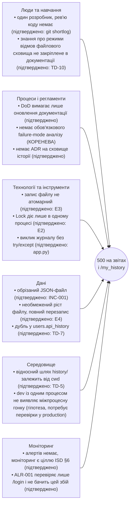

# Post-Mortem INC-001: відмова аналітики через пошкоджений файл історії

Post-Mortem (посмертний розбір) відповідає на питання «чому це сталося і що змінити в системі». Це **беззвинувачувальний** (blameless) аналіз: розглядаються системи і процеси, а не люди, бо покарання за чесний звіт гарантує, що наступний звіт буде брехливим. Факти про сам збій: [INC-001](INC-001.md). Дії за результатами: розділ 6 і [план CAPA](capa-INC-001.md).

## 1. Зведення

За хвилину до збою все працювало. О 21:03:13 UTC файл `history/user_2.json` було обрізано посеред JSON, після чого всі запити користувача `operator` до `/api/query6` та `/my_history` повертали 500 до ручного втручання о 21:03:24 UTC. Втрати даних БД немає, SLA не порушено, але механізм збою відтворюваний і в реальному середовищі міг би тривати годинами.

## 2. Ланцюжок «5 Чому» (5 Whys)

Кожна відповідь підтверджена доказом: рядком коду, логом, метрикою чи комітом. Кожна наступна причина лежить глибше за попередню, а остання знаходиться в процесі, а не в людині.

| # | Питання | Відповідь | Доказ |
|---|---|---|---|
| 1 | Чому користувач отримав 500 на `/api/query6` і `/my_history`? | Бо `json.load` кинув `JSONDecodeError` на обрізаному файлі `history/user_2.json`, і виняток дійшов до Flask необробленим | лог `INC-001-timeline.log`: 21:03:13Z `DETECT ... GET /api/query6 -> 500`; `history_utils.py:23-24` (`json.load` без обробки); експеримент E3 у `scripts/legacy_history_probe.py` |
| 2 | Чому виняток журналу історії зламав основний звіт? | Бо запис історії виконується у тілі обробника запиту без ізоляції збою: допоміжна функція стоїть на критичному шляху основного сценарію, а звіт на момент виклику вже порахований | `app.py:1342` (`add_history_entry` у `/api/query6`), аналогічно 12 інших викликів (рядки 1101, 1111, 1155, 1182, 1215, 1241, 1273, 1385, 1414, 1424, 1460, 1491); `app.py:1562` (`load_history` у `/my_history` без обробки); реєстр боргу TD-3 |
| 3 | Чому файл узагалі міг опинитися обрізаним? | Бо `save_history` відкриває файл у режимі `"w"` (миттєво обрізає його) і лише потім пише вміст: запис не атомарний, а читач або збій процесу в проміжку бачить частковий JSON | `history_utils.py:26-29`; експеримент E2: при чотирьох процесах 87 із 400 записів збережено і 81 збій (запуск на macOS, метод `spawn`), файл пошкоджується; реєстр боргу TD-2 |
| 4 | Чому сховище було побудоване на запису файлу «на місці» із блокуванням лише в межах процесу? | Бо модуль зростав латкою: проблему гонки, знайдену під k6-навантаженням, закрили локальним `threading.Lock`, а сам вибір файлового сховища для даних, що змінюються, не переглядали і не фіксували в ADR; блокування не діє між процесами | коментар `history_utils.py:9-13` («Виявлено під час k6-навантаження»); коміт `388c4f3` (Lab2); реєстр ADR містить лише ADR-0001...0004 і жодного про сховище історії; експеримент E2 |
| 5 | Чому ці дефекти дожили до використання і не були виявлені заздалегідь? | **Процес розробки і контролю якості не вимагає аналізу режимів відмови та тестів на відмову для кожного компонента, що зберігає стан.** Quality gates перевіряють складність (Radon), секрети (Gitleaks) і актуальність документації, а симуляція відмов (`fault_injection.py`) застосована лише до одного виклику БД в `/api/query6`. Для `history_utils.py` не було ні тестів, ні алерта | `scripts/hooks/pre-commit` (лише Gitleaks і Radon); `fault_injection.py` і `app.py:1303` (єдина точка використання `maybe_inject_fault`); у `tests/` немає тестів `history_utils.py` (TD-8); каталог алертів RB-001: ALR-001 перевіряє лише `/login`, який у INC-001 увесь час повертав 200; чек-лист DoD у `CONTRIBUTING.md` стосується тільки документації |

**Коренева причина (root cause):** у процесі розробки немає обов'язкового кроку «аналіз режимів відмови + тест на відмову» для допоміжних компонентів зі станом. Це системна причина, а не помилка конкретної людини: процес дозволяв пропустити цей крок і не показував, що його пропущено.

**Чому відповідь не обривається на людині.** Формулювання на кшталт «розробник забув обробити виняток» було відкинуте: будь-яка людина в такому процесі без перевірки відмов зробила б те саме, а покарання не виправило б процес. Тому аналіз іде до правила, яке дозволило пропуск (Why 5).

## 3. Діаграма Ісікави («риб'яча кістка»)

Ефект (голова): **500 на аналітиці через пошкоджений файл історії**. Категорії і гіпотези, кожна з вердиктом.

Висновок за діаграмою: більшість підтверджених гілок (технології, дані, моніторинг) є наслідками однієї гілки «Процеси і регламенти» (відсутній обов'язковий аналіз відмов), що узгоджується з ланцюжком «5 Чому».

## 4. Що спрацювало добре

- Перед інцидентом зроблено резервну копію файлу, а пошкоджений файл не видалено, а збережено як доказ.
- Тимчасовий обхід виконано за секунди: код уже трактує відсутній файл як порожню історію.
- Усі події фіксувалися з UTC-часом автоматично, тому хронологія відновлена без здогадок.
- Збій локалізовано: інші користувачі не постраждали, дані БД цілі.

## 5. Що пішло не так

- Виявлення було ручним, жоден алерт не вказав би на проблему.
- Допоміжна функція (журнал історії) зламала основну.
- Файл пошкоджується без жодного повідомлення, лише при наступному читанні.

## 6. Висновки і дії

Дії винесено в [план CAPA](capa-INC-001.md): коригувальні (усувають причину цього збою) та попереджувальна (усуває причину потенційного збою, виявленого RCA).
