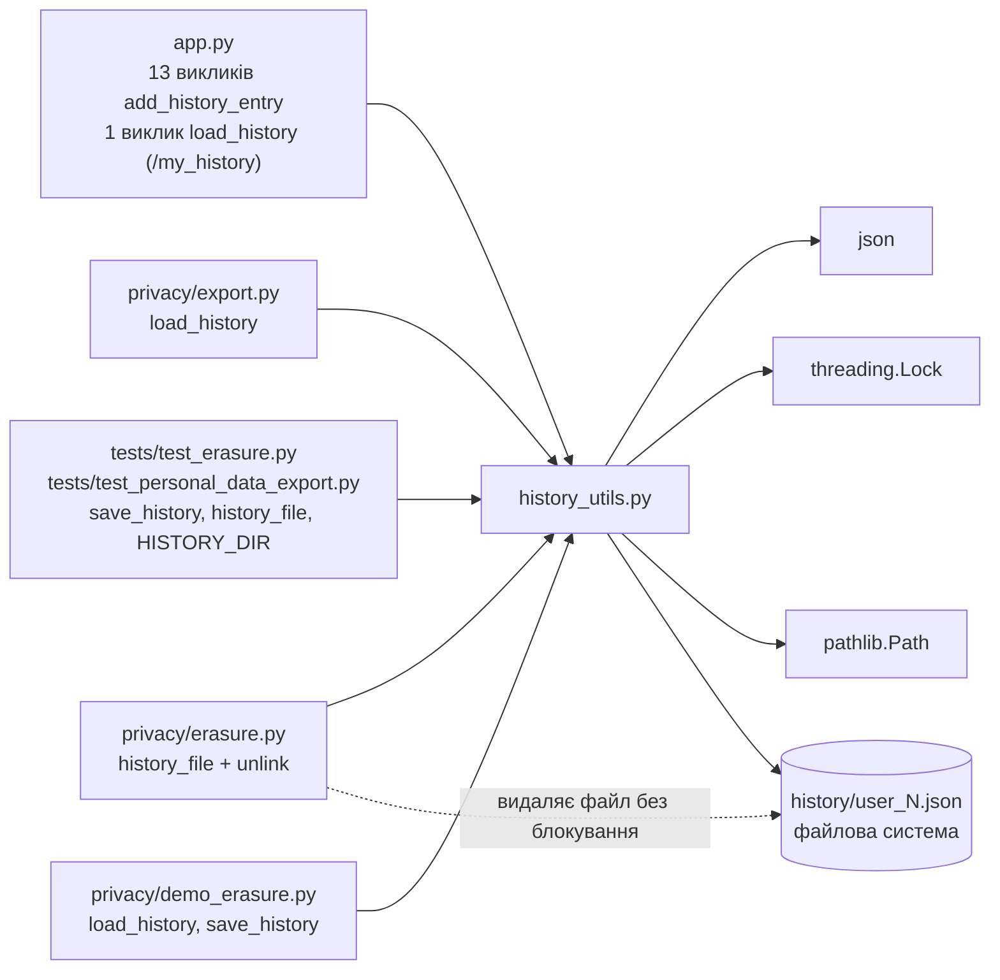

# Legacy-компонент `history_utils.py`: відновлена документація

Це результат міні-реверс-інжинірингу (reverse engineering, відновлення знання з готового коду) найменш документованого компонента. Вибір обґрунтовано аудитом ЛР10: модуль має лише один коментар про блокування, а в [SDD](../architecture/sdd.md) описаний одним рядком. Модуль має 41 рядок.

**Рівні довіри** кожного твердження:

- **verified** (перевірено інструментально: аналізом коду, `grep` або запуском [scripts/legacy_history_probe.py](../../scripts/legacy_history_probe.py));
- **assumed** (гіпотеза, потребує перевірки; поруч вказано, як її перевірити).

## 1. Призначення і публічний інтерфейс

Модуль веде персональну історію аналітичних запитів користувача: що він запитував, з якими параметрами і який короткий результат отримав. Дані показує сторінка `/my_history`.

| Елемент | Що робить | Довіра |
|---|---|---|
| `HISTORY_DIR = Path("history")` | каталог сховища; шлях відносний, тому залежить від каталогу запуску процесу; `mkdir(exist_ok=True)` виконується при імпорті модуля | verified (код, рядки 6-7; запуск: імпорт з іншого каталогу створює там власний `history/`) |
| `_history_lock` | один `threading.Lock` на весь процес, захищає read-modify-write від гонки потоків (race condition) | verified (код, рядок 14; експеримент E1: 8 потоків x 100 записів дають рівно 800) |
| `history_file(user_id)` | повертає шлях `history/user_<id>.json` | verified (код, рядок 16-17) |
| `load_history(user_id)` | читає файл; якщо файлу немає, повертає `[]`; пошкоджений JSON кидає `JSONDecodeError` без обробки | verified (код, рядки 19-24; експеримент E3) |
| `save_history(user_id, list)` | відкриває файл на запис (`"w"`, обрізає його) і дампить увесь список; запис не атомарний | verified (код, рядки 26-29) |
| `add_history_entry(user_id, api_name, params, result_text)` | під блокуванням: прочитати файл → додати запис → записати весь файл | verified (код, рядки 31-42) |
| Призначення полів `api`, `params`, `result`, `timestamp` | `api`: назва запиту; `params`: рядок із фільтрами; `result`: короткий підсумок, наприклад «Знайдено 0 продажів»; `timestamp`: локальний час сервера без часового поясу | verified (код і зразок `history/user_1.json`) |
| Рішення зберігати історію у файлах, а не лише в `users.api_history` | початково (до ЛР2) було швидким рішенням, друге джерело в БД лишилося | assumed (перевірити за `git log -p` перших комітів і запитати автора; `privacy/export.py` об'єднує обидва джерела без дублів, що підтверджує існування двох сховищ) |

## 2. Граф залежностей



Хто викликає компонент: `app.py` (рядок 10 імпорт; запис у 13 маршрутах аналітики й кастомного SQL, читання в `/my_history`), `privacy/export.py` (читання при експорті персональних даних), `privacy/erasure.py` (видалення файлу при анонімізації), 2 тести та 1 демо-скрипт. **verified** (`grep -rn "history_utils"` по репозиторію). Кого викликає компонент: стандартні `json`, `threading`, `pathlib`, `datetime` і файлову систему; зовнішніх залежностей і БД немає. **verified** (код, рядки 1-4).

## 3. Формат даних

Один файл на користувача, `history/user_<id>.json`. Вміст: JSON-масив об'єктів у порядку додавання (нові в кінці).

```json
[
  {
    "api": "Запит 6: Деталі продажів",
    "params": "Дата: 2026-11-10; місяць: 11; категорія: Художня література; постачальник: Видавництво Старого Лева",
    "result": "Знайдено 0 продажів",
    "timestamp": "2026-11-17 21:14:03"
  }
]
```

Схема полів: чотири рядкові поля. **verified** (код і реальний файл). Обмеження довжини, ротації чи максимальної кількості записів немає. **verified** (код; експеримент E4).

## 4. Результати інструментальної перевірки

Запуск: `python scripts/legacy_history_probe.py` (працює в тимчасовому каталозі, реальні дані не чіпає).

| Експеримент | Що перевіряє | Результат | Висновок |
|---|---|---|---|
| E1 | 8 потоків x 100 записів в одному процесі | 800 з 800 | блокування від гонки потоків працює |
| E2 | 4 процеси x 100 записів (імітація кількох воркерів gunicorn) | пошкодження файлу `JSONDecodeError`, лише частина записів збережена | `threading.Lock` не діє між процесами |
| E3 | файл, обрізаний посеред запису | `load_history` кидає `JSONDecodeError` | пошкоджений файл не відновлюється сам |
| E4 | додавання запису при 3000 наявних | близько 10 мс, файл 474 КБ | кожен запис перечитує й перезаписує весь файл: час росте лінійно |
| E5 | видалення файлу (як робить erasure) і наступний запис | файл створюється знову | запис після анонімізації відтворює історію користувача |

## 5. Реєстр технічного боргу і відомих ризиків

Типологія з Лекції 10: architecture debt (архітектурний борг), code debt (борг у коді), test debt (борг у тестах), documentation debt (борг у документації). Серйозність: висока (втрата чи пошкодження даних, збій користувацького сценарію), середня, низька.

| ID | Тип | Опис боргу | Наслідки | Серйозність | Довіра |
|---|---|---|---|---|---|
| TD-1 | architecture | сховище у локальних файлах із блокуванням, чинним лише в межах процесу | при розгортанні кількох воркерів (ціль ISD §2: gunicorn) втрата записів і пошкодження файлу (E2) | висока | verified (E2); сам факт множинних воркерів у production: assumed, перевірити конфігурацією розгортання |
| TD-2 | code | запис не атомарний: файл відкривається на запис (обрізається) і лише потім наповнюється | збій чи зупинка процесу посеред запису лишає обрізаний файл (E3); після цього кожен `add_history_entry` цього користувача кидає виняток | висока | verified (код, E3) |
| TD-3 | code | у 13 маршрутах `add_history_entry` викликається без `try/except`, а `/my_history` без обробки `load_history` | допоміжна функція (журнал історії) ламає основний сценарій: звіт, що вже порахований, віддає 500; сторінка історії теж 500 | висока | verified (код `app.py`: рядки 1155, 1342, 1562) |
| TD-4 | code | кожен запис перечитує й перезаписує весь файл; ліміту розміру і ротації немає | час запису і розмір файлу ростуть лінійно (E4); з часом сповільнення звітів і диск | середня | verified (E4) |
| TD-5 | code | `HISTORY_DIR` відносний, `mkdir` при імпорті модуля | запуск застосунку з іншого каталогу створює інший `history/` і «губить» історію; побічний ефект при імпорті | середня | verified (код, E-перевірка імпорту) |
| TD-6 | architecture / privacy | `privacy/erasure.py` видаляє файл без блокування модуля, а наступний запис створює його знову | запит, що виконувався під час анонімізації, відновлює історію користувача (порушення права на стирання) | середня | verified (код, E5); реальна ймовірність збігу у часі: assumed, перевірити стрес-тестом |
| TD-7 | architecture | дві копії тих самих даних: `history/*.json` і поле `users.api_history` у БД | дублювання, розбіжності, ускладнений експорт (потрібна дедуплікація у `privacy/export.py`) | середня | verified (`privacy/export.py`, SDD §4) |
| TD-8 | test | немає тестів самого `history_utils.py`: гонка, пошкоджений файл, порожній каталог; є лише непрямі використання в тестах приватності | регресії в цьому модулі нічим не ловляться | середня | verified (у `tests/` немає файлу `test_history*`; `grep` показує лише використання в `test_erasure.py`, `test_personal_data_export.py`) |
| TD-9 | code / privacy | `history/user_2.json` перебуває під контролем Git, `history/` немає в `.gitignore` | історія запитів користувача (включно з текстом SQL) потрапляє в репозиторій | середня | verified (`git ls-files history`); чи містить текст SQL чутливі дані: assumed, перевірити вмістом файлу |
| TD-10 | documentation | у модуля немає docstring; SDD описує його одним рядком; формат файлу, інваріанти й обмеження ніде не записані; резервне копіювання `history/` лише ціль | новий розробник або черговий не знає про обмеження TD-1...TD-6 | низька | verified (код, SDD §3, ISD §4); цей документ частково закриває борг |
| TD-11 | code | `timestamp` у локальному часі сервера без часового поясу | неоднозначність при зміні часового поясу чи літнього часу; у звітах про інциденти потрібен UTC | низька | verified (код, рядок 39; `privacy/export.py` це визнає в примітці) |

## 6. Пріоритети технічного вдосконалення

Пріоритет визначається серйозністю та віддачею (скільки ризику знімає дія). Дії розподілено в [плані підтримки](../maintenance-plan.md) (створюється наприкінці Завдання 3).

1. TD-2 і TD-3: атомарний запис (тимчасовий файл і `os.replace`) та ізоляція збою журналу історії від основного сценарію.
2. TD-1 і TD-7: перенести історію в таблицю БД (ліквідує дві копії і міжпроцесну гонку).
3. TD-8: тести на гонку, пошкоджений файл і відсутній каталог.
4. TD-6 і TD-9: узгодити стирання з блокуванням, додати `history/` у `.gitignore`.
5. TD-4, TD-5, TD-11: ліміт розміру, абсолютний шлях із конфігурації, UTC.
