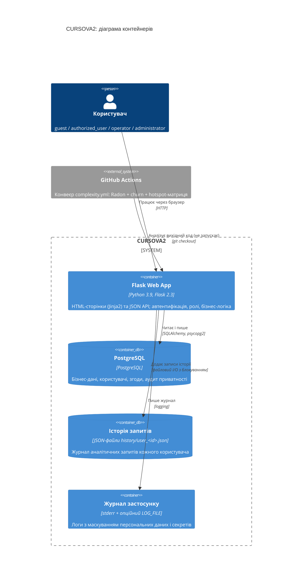
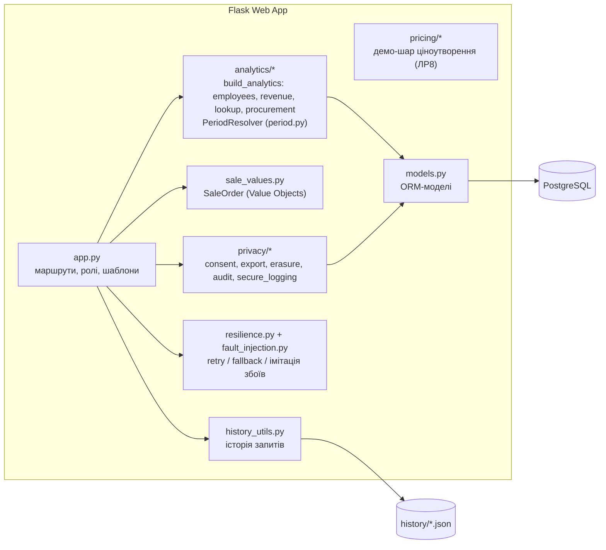
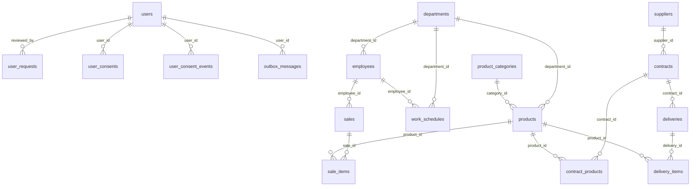

# SDD: документ проєктування системи (System Design Document)

Цей документ відповідає на питання «як система влаштована всередині». Де і на чому вона працює, описано в [isd.md](isd.md). Чому вибрано саме такі рішення, описано в [ADR](architecture/adr/).

Власник: Mariia Hutsuliak. Цикл перегляду: 180 днів (архітектурна документація), див. [maintenance.md](maintenance.md).

## 1. Контекст і межі

Система складається з одного вебзастосунку (Flask), реляційної бази PostgreSQL і файлового сховища історії запитів. Зовнішніх сервісів у runtime немає: поштова розсилка та аналітика зараз лише ставляться в чергу (таблиця `outbox_messages`), реальної відправки немає.

## 2. C4-діаграма контейнерів (C4 Container Diagram)

C4 (Context, Containers, Components, Code) описує систему на рівнях деталізації. Нижче рівень контейнерів: окремі процеси та сховища, які розгортаються окремо.

## 3. Компоненти Flask-застосунку

| Компонент | Відповідальність | Ключові залежності (взаємодіє з) | Розгортання (ISD) |
|---|---|---|---|
| `app.py` | маршрути, декоратори ролей (`requires_role`), робота зі сторінками й JSON API, ініціалізація Flask | `models.py`, `analytics/`, `sale_values.py`, `history_utils.py`, `resilience.py`, `privacy/*` | [isd.md §2](isd.md) |
| `models.py` | ORM-моделі (SQLAlchemy) усіх бізнес-таблиць і користувачів | PostgreSQL | [isd.md §4](isd.md) |
| `analytics/` | аналітичний шар (ЛР8, замість колишнього God Object `queries.py`): `build_analytics(session)` у `__init__.py` є composition root і повертає чотири сервіси: `EmployeeQueries` (запити 1, 5, 7), `RevenueQueries` (2, 10), `ProcurementQueries` (3, 9), `LookupQueries` (4, 6, 8). Календарну логіку періодів ізольовано за інтерфейсом `PeriodResolver` (`contracts.py`) з реалізацією `CalendarPeriodResolver` (`period.py`) | `models.py`, `app.py` викликає через `analytics_services` | [isd.md §2](isd.md) |
| `pricing/` | демонстраційний шар ціноутворення (ЛР8): `BasePriceCalculator`, `RetailPriceCalculator`, `LoyaltyPriceCalculator` з композицією замість успадкування; `app.py` його не імпортує, використовується тестами і скриптом `scripts/lab8_inheritance_test.py` | сам по собі, залежностей від `models.py` немає | [isd.md §2](isd.md) |
| `sale_values.py` | незмінні Value Objects для розрахунку суми продажу (результат рефакторингу ЛР6) | використовується з `app.py` | [isd.md §2](isd.md) |
| `history_utils.py` | запис і читання історії запитів користувача з блокуванням від race condition | файлова система (`history/`) | [isd.md §4](isd.md) |
| `resilience.py`, `fault_injection.py` | обмежений Retry з backoff (3 спроби, 0.3 с, множник 2), контрольований Fallback, імітація збоїв БД через `DB_FAULT_MODE` | `app.py`, `sqlalchemy.exc` | [isd.md §3](isd.md) |
| `privacy/consent.py` | політика згод (marketing_email, optional_analytics), версії політики, outbox-черга | `models.py`, `privacy/audit.py` | [isd.md §4](isd.md) |
| `privacy/export.py`, `privacy/erasure.py` | право доступу (експорт) і право на видалення (анонімізація) | `models.py`, `privacy/audit.py` | [isd.md §4](isd.md) |
| `privacy/secure_logging.py`, `privacy/sanitizer.py` | маскування PII та редагування секретів у логах | `app.py` (підключення при старті) | [isd.md §5](isd.md) |
| `templates/` | HTML-шаблони Jinja2 для сторінок системи | `app.py` | [isd.md §2](isd.md) |

## 4. Модель даних

Додаткові таблиці без зовнішніх ключів: `privacy_audit_events` (журнал подій приватності з `subject_id`, `actor_id`, `outcome`, `correlation_id`). Поле `users.api_history` (JSON) існує в моделі; основна історія зберігається у файлах `history/`.

Особливості: поле `Sale.sold_on` в ORM відображається на колонку `sale_date` у таблиці `sales` (перейменування атрибута в ЛР8 без зміни схеми БД); м'яке видалення через `is_deleted` (employees, suppliers, contracts, products); суми (`total_amount`, `price`) зберігаються як `Numeric(10, 2)`.

## 5. API-контракти

Усі JSON-маршрути потребують автентифікації (Flask-Login). Рівні доступу: A = `authorized_user` і вище, O = `operator` і вище. Для маршрутів `/api/users/...` авторизація виконується всередині модулів `privacy/*`: доступ має сам власник даних або адміністратор, іншим повертається 403.

| Маршрут | Метод | Доступ | Призначення | Взаємодіє з |
|---|---|---|---|---|
| `/api/query1` | GET | A | Інформація про працівників (фільтри: відділ, керівники, у відпустці) | `analytics/employee_queries.py` |
| `/api/query2` | GET | A | Аналіз виручки (період, категорія) | `analytics/revenue_queries.py` |
| `/api/query3` | GET | A | Договори за періодом (місяць/інший тип періоду) | `analytics/procurement_queries.py` |
| `/api/query4` | GET | A | Постачальники без настільних ігор | `analytics/lookup_queries.py` |
| `/api/query5` | GET | A | Найкращі продажі за мінімальною сумою і періодом | `analytics/employee_queries.py` |
| `/api/query6` | GET | A | Інформація про продажі (дата, місяць, категорія, постачальник); навантажувально протестований k6 | `analytics/lookup_queries.py` |
| `/api/query7` | GET | A | Кількість працівників (дата, відділ) | `analytics/employee_queries.py` |
| `/api/query8` | GET | A | Постачальник за номером договору | `analytics/lookup_queries.py` |
| `/api/query9` | GET | A | Вартість товарів постачальника на дату (`supplier_name`, `target_date`) | `analytics/procurement_queries.py`, `history_utils.py` |
| `/api/query10` | GET | A | Тижневий аналіз продажів (`from_date`) | `analytics/revenue_queries.py`, `history_utils.py` |
| `/api/custom-sql` | POST | O | Довільний SELECT (заблоковані drop/delete/alter/truncate/update) | PostgreSQL напряму |
| `/api/users/<int:user_id>/personal-data` | GET | власник даних або адміністратор | Експорт персональних даних (право доступу) | `privacy/export.py` |
| `/api/users/<int:user_id>/anonymize` | POST | власник даних або адміністратор | Анонімізація, тіло `{"confirm": true}` | `privacy/erasure.py` |
| `/api/users/<int:user_id>/consents` | GET | власник даних або адміністратор | Список згод | `privacy/consent.py` |
| `/api/users/<int:user_id>/consents/<purpose>/grant` | POST | власник даних або адміністратор | Надати згоду | `privacy/consent.py` |
| `/api/users/<int:user_id>/consents/<purpose>/revoke` | POST | власник даних або адміністратор | Відкликати згоду | `privacy/consent.py` |
| `/api/users/<int:user_id>/marketing-email` | POST | власник даних або адміністратор | Поставити маркетинговий лист у чергу (лише за згодою) | `privacy/consent.py` |
| `/api/users/<int:user_id>/analytics-event` | POST | власник даних або адміністратор | Записати аналітичну подію (лише за згодою) | `privacy/consent.py` |

Сторінкові маршрути (HTML) `/employees`, `/products`, `/sales`, `/deliveries`, `/suppliers`, `/reports`, `/admin/*` описані за шаблоном «список, `add`, `edit/<id>`, `delete/<id>`» і не є контрактами між компонентами.

## 6. Контракти поведінки для QA

Автотести в `tests/` фіксують очікувану поведінку: `test_sale_values.py` і `test_edit_sale.py` (розрахунок продажів), `test_period_resolver.py` (календарні періоди аналітики), `test_pricing_contract.py` (контракти шару ціноутворення), `test_consent.py`, `test_erasure.py`, `test_personal_data_export.py` (privacy), `test_secure_logging.py` (маскування логів), `test_resilience.py` (retry/fallback), `test_chapin_mutation.py` (мутаційне тестування). Запуск: `python -m pytest tests/`.
